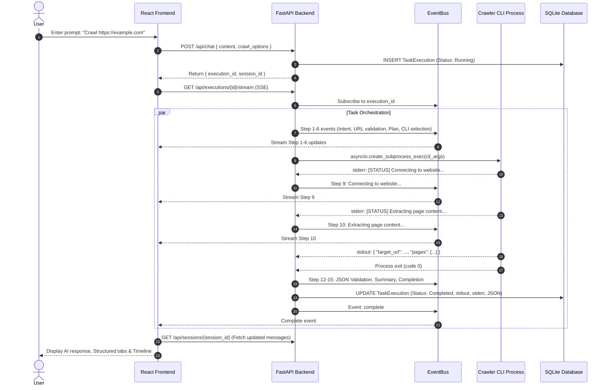

# System Architecture — WorkElate AI Agent

## 1. System Overview

WorkElate is a production-grade, CLI-powered AI agent chat application. It bridges the gap between natural-language user intentions and deterministic, controlled CLI subprocess execution, featuring real-time activity transparency over Server-Sent Events (SSE).

```mermaid
graph TD
    User([User in Web Browser]) -->|HTTP / SSE| Frontend[Vite + React 18 + Tailwind UI]
    Frontend -->|REST: POST /api/chat| FastAPIServer[FastAPI Backend Engine]
    Frontend -->|SSE: /api/executions/:id/stream| FastAPIServer

    subgraph Backend Core
        FastAPIServer --> AIIntent[AI Intent Service\nGemini API / Rule Fallback]
        AIIntent --> SecurityCheck[Security Validator\nAnti-SSRF & DNS Resolv]
        SecurityCheck --> TaskOrch[Task Orchestrator]
        TaskOrch --> EventBus[In-Memory Async Event Bus]
        EventBus -->|Live SSE Stream| Frontend
        TaskOrch --> CLIRegistry[Approved CLI Registry]
        CLIRegistry --> Runner[CLI Async Runner\nasyncio.create_subprocess_exec]
    end

    subgraph Isolated CLI Subprocess
        Runner -->|spawn without shell| CrawlerCLI[Crawler CLI Subprocess\napp.crawler.cli]
        CrawlerCLI -->|HTTP/TLS| TargetSite[(Target Website)]
        CrawlerCLI -->|stderr: [STATUS] events| Runner
        CrawlerCLI -->|stdout: Structured JSON| Runner
    end

    subgraph Post Processing & Storage
        Runner --> OutputParser[JSON Output Parser]
        OutputParser --> Summarizer[AI Summarizer Service]
        Summarizer --> Database[(SQLite / Postgres\nSQLAlchemy Async)]
        Database --> FastAPIServer
    end
```

---

## 2. Component Architecture

### A. Frontend Components
- **`App.tsx`**: Top-level coordinator managing chat sessions, active execution stream, parameter popups, and sidebar.
- **`ActivityPanel.tsx`**: The Live AI Activity Transparency view. Renders the 15-step chronological timeline with dynamic status badges (`pending`, `in_progress`, `completed`, `failed`), and allows toggling to the developer technical log view.
- **`StructuredResultView.tsx`**: Multi-tab viewer embedded directly in AI responses:
  1. *AI Summary*: Markdown synthesis with executive takeaways.
  2. *Extracted Content*: Page title, description, H1/H2 headings, key paragraphs.
  3. *Crawled Pages*: Detailed table with HTTP status, latency, and depth.
  4. *Structured JSON*: Formatted raw crawler output with Copy & Download JSON buttons.
  5. *CLI Logs*: Complete stdout and stderr outputs.
- **`ChatInput.tsx`**: Multiline auto-expanding textarea, example prompt suggestions, crawl depth/pages selector, and stop button.
- **`ExecutionHistoryModal.tsx`**: Modal for browsing persistent database records of previous tasks with full inspection and rerun capability.
- **`useSSE.ts`**: React hook listening to `/api/executions/{id}/stream`, streaming status updates and stdout/stderr into local state.

### B. Backend Services
- **`AIIntentService` (`app/services/ai_intent.py`)**:
  - Classifies natural language requests (`website_crawling` vs `general_query`).
  - Extracts target URL, depth, and max pages.
  - Constructs a 15-step execution plan.
  - Integrates Gemini API (`google.generativeai`) with a deterministic regex/rule fallback.
- **`SecurityValidator` (`app/services/security_validator.py`)**:
  - Validates URL syntax and restricts protocol to HTTP and HTTPS.
  - Resolves domain DNS and blocks loopback (`127.0.0.1`, `::1`), private networks (`10.0.0.0/8`, `172.16.0.0/12`, `192.168.0.0/16`), link-local (`169.254.0.0/16`), and AWS/GCP cloud metadata services.
  - Sanitizes log streams to redact API keys and bearer tokens.
- **`CLIRegistry` (`app/cli_engine/registry.py`)**:
  - Whitelist of approved CLI executables. Prevents arbitrary shell execution.
  - Safely assembles argument arrays (e.g. `["python", "-m", "app.crawler.cli", "--url", "..."]`).
- **`CLIExecutionRunner` (`app/cli_engine/runner.py`)**:
  - Executes subprocess programmatically using `asyncio.create_subprocess_exec` (`shell=False`).
  - Streams stdout and stderr lines asynchronously.
  - Enforces process execution timeouts and returns clean `CLIExecutionResult` with exit codes.
- **`WebCrawlerEngine` & `CrawlerCLI` (`app/crawler/`)**:
  - Standalone CLI crawler powered by `httpx` and `BeautifulSoup4`.
  - Crawls websites up to configured depth and page limits.
  - Extracts titles, metadata tags, OpenGraph attributes, headings, clean paragraphs, and links.
  - Emits real-time progress events on `stderr` and valid structured JSON on `stdout`.
- **`AISummarizerService` (`app/services/summarizer.py`)**:
  - Synthesizes executive summaries from the extracted data.
  - Treats crawled content strictly as untrusted data to protect against prompt injection.
- **`EventBus` (`app/services/event_bus.py`)**:
  - In-memory async pub-sub bus that multiplexes live execution events to SSE subscribers.
- **`TaskOrchestrator` (`app/services/task_orchestrator.py`)**:
  - Manages the lifecycle: DB initialization $\to$ Intent analysis $\to$ Security validation $\to$ Plan creation $\to$ CLI invocation $\to$ Live event streaming $\to$ JSON validation $\to$ Summary $\to$ DB finalization.

---

## 3. Real-Time Communication Sequence



---

## 4. Security Boundaries & Protections

1. **Anti-SSRF Protection**: All target URLs must resolve to public, routable IP addresses. Private IP ranges (`10.0.0.0/8`, `172.16.0.0/12`, `192.168.0.0/16`, `127.0.0.0/8`), loopback (`::1`), link-local, and cloud metadata hostnames (`169.254.169.254`, `metadata.google.internal`) are rejected with explicit security violation codes before any connection is attempted.
2. **Subprocess Isolation**: Subprocesses are launched via `asyncio.create_subprocess_exec` using argument lists. No shell interpolation (`shell=True`) is ever used, eliminating shell injection vectors.
3. **Whitelisted CLI Registry**: Only commands defined in `CLIRegistry` can be executed. Raw LLM inputs cannot specify arbitrary commands or binary paths.
4. **Execution Timeouts**: Subprocesses are bounded by a strict timeout (default: 60s). Timed-out processes are terminated gracefully (`SIGTERM`), followed by force-kill (`SIGKILL`) if unresponsive.
5. **Untrusted Data Isolation**: All extracted HTML and text are treated as untrusted data. AI prompts are engineered to isolate external content and instruct LLMs not to follow commands embedded within crawled websites.
6. **Log Redaction**: Standard output and error streams pass through secret scrubbing filters that redact API keys, Bearer tokens, and sensitive headers before transmission or storage.
